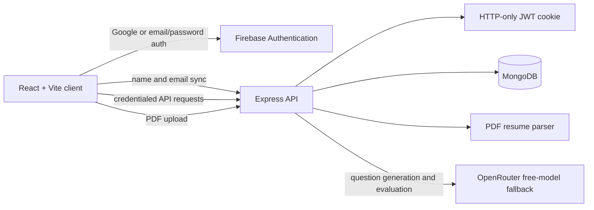

# MockMate

MockMate is a full-stack AI mock interview platform for candidates preparing for technical, HR, and managerial interviews. It turns interview preparation into a timed conversation: users choose a role, optionally provide a resume, answer questions by voice or text, and receive structured feedback on their final report.

The project demonstrates a React client, an Express/MongoDB API, Firebase authentication, PDF processing, JWT session cookies, and an OpenRouter integration with model fallback handling.

## Key Features

### Interview workflow

- Role, experience, and interview-mode configuration
- Optional PDF resume upload with text extraction
- Resume-aware question generation
- Five questions with progressive difficulty and time limits
- Voice input through the browser Web Speech API
- Female AI interviewer video and spoken prompts
- Answer submission with server-side persistence

### Evaluation and reporting

- AI scoring for confidence, communication, and correctness
- Candidate answer, ideal answer, and AI feedback shown in the final report
- Expandable question-by-question feedback sections
- Overall score and skill averages
- Interview history and report pages
- PDF report generation with `jsPDF` and `jspdf-autotable`

### Authentication and account data

- Google sign-in through Firebase Authentication
- Firebase email/password sign-in and account creation
- Seven-day JWT session stored in an HTTP-only cookie
- MongoDB-backed users, interviews, scores, and feedback
- New users receive an application balance of 150 credits; one interview consumes 50 credits

## Tech Stack

| Area | Technologies |
| --- | --- |
| Frontend | React 19, Vite, React Router, Redux Toolkit, Axios |
| UI | Tailwind CSS v4, Motion, React Icons |
| Reporting | Recharts, React Circular Progressbar, jsPDF, jspdf-autotable |
| Authentication | Firebase Authentication, JWT, HTTP-only cookies |
| Backend | Node.js, Express, cookie-parser, CORS |
| Database | MongoDB with Mongoose |
| AI | OpenRouter Chat Completions API with free-model fallback |
| File processing | Multer and `pdfjs-dist` |
| Deployment configuration | Vercel SPA rewrite for the client |

## Demo and Screenshots

No live deployment URL is currently verified in this repository, so no demo link is advertised here.

The repository currently does not contain a `screenshots/` directory. The client does include product assets under `client/src/assets/`, but they are used inside the application rather than as README screenshots. Adding one landing-page screenshot and one final-report screenshot would make the repository easier to evaluate quickly.

## Architecture



### Request flow

1. Firebase authenticates the user in the browser.
2. The client sends the Firebase user's name and email to the API.
3. The API creates or finds the MongoDB user and issues a JWT cookie.
4. Authenticated requests use that cookie through Axios `withCredentials`.
5. Resume text and interview context are sent to OpenRouter for question generation.
6. Submitted answers are evaluated and stored with per-question scores and feedback.
7. The final report reads the persisted interview document and presents the full breakdown.

## Project Structure

```text
.
├── client/
│   ├── public/              # Favicon and public client files
│   └── src/
│       ├── components/      # Auth, interview, navigation, timer, and report UI
│       ├── pages/            # Home, auth, interview, history, and report routes
│       ├── redux/            # User session state
│       ├── services/         # Speech recognition and route transitions
│       └── utils/            # Firebase initialization
├── server/
│   ├── config/              # MongoDB and JWT configuration
│   ├── controllers/         # Auth, interview, and user request handlers
│   ├── middlewares/          # JWT auth and PDF upload validation
│   ├── models/               # User and interview schemas
│   ├── routes/               # Express route modules
│   └── services/             # OpenRouter integration
├── client/.env.example
├── server/.env.example
└── README.md
```

## Local Setup

### Prerequisites

- Node.js LTS and npm
- A MongoDB local instance or MongoDB Atlas database
- A Firebase web app with Google and Email/Password providers enabled
- An OpenRouter API key

### 1. Configure the client

```bash
cp client/.env.example client/.env
```

Set the Firebase web-app values and API URL in `client/.env`:

```dotenv
VITE_SERVER_URL=http://localhost:5000
VITE_FIREBASE_API_KEY=your_firebase_api_key
VITE_FIREBASE_AUTH_DOMAIN=your-project.firebaseapp.com
VITE_FIREBASE_PROJECT_ID=your_firebase_project_id
VITE_FIREBASE_STORAGE_BUCKET=your-project.firebasestorage.app
VITE_FIREBASE_MESSAGING_SENDER_ID=your_firebase_messaging_sender_id
VITE_FIREBASE_APP_ID=your_firebase_app_id
VITE_FIREBASE_MEASUREMENT_ID=your_firebase_measurement_id
```

The measurement ID is optional for authentication. In Firebase Console, enable Google and Email/Password sign-in and add `localhost`, `127.0.0.1`, and the production frontend domain to Authorized Domains.

### 2. Configure the server

```bash
cp server/.env.example server/.env
```

Set the server values:

```dotenv
MONGODB_URL=mongodb://localhost:27017
JWT_SECRET_KEY=replace_with_a_long_random_secret
OPENROUTER_API_KEY=your_openrouter_api_key
PORT=5000
NODE_ENV=development
```

The database name is `ai-interview-agent`, defined in `server/config/constants.js`. If a MongoDB username or password contains reserved URL characters such as `@`, URL-encode them before placing them in `MONGODB_URL`.

### 3. Install dependencies

```bash
cd server
npm install

cd ../client
npm install
```

### 4. Start both applications

In one terminal:

```bash
cd server
npm run dev
```

In another terminal:

```bash
cd client
npm run dev
```

The API defaults to `http://localhost:5000`. The Vite client normally runs at `http://localhost:5173`. If port 5000 is unavailable, choose another server port and set the same value in `VITE_SERVER_URL`.

### Available scripts

Client:

```bash
npm run dev
npm run build
npm run lint
npm run preview
```

Server:

```bash
npm run dev
npm start
```

## API Reference

All routes below are mounted under the API server origin. Authenticated routes require the HTTP-only `token` cookie.

| Method | Route | Purpose | Auth |
| --- | --- | --- | --- |
| `POST` | `/api/auth/google` | Sync a Firebase user and create a JWT session. The endpoint is also used by the email/password client flow. | No |
| `POST` | `/api/auth/logout` | Clear the authentication cookie. | No |
| `GET` | `/api/user/current-user` | Return the authenticated MongoDB user. | Yes |
| `POST` | `/api/interview/resume` | Upload and parse a PDF resume. Multipart field: `resume`. | Yes |
| `POST` | `/api/interview/generate-questions` | Generate and persist five interview questions. | Yes |
| `POST` | `/api/interview/submit-answer` | Evaluate and persist one answer. | Yes |
| `POST` | `/api/interview/finish` | Mark an interview complete and calculate aggregate scores. | Yes |
| `GET` | `/api/interview/get-interview` | List the current user's interview history. | Yes |
| `GET` | `/api/interview/report/:interviewId` | Return aggregate metrics and question-level report data. | Yes |

### Generate questions body

```json
{
  "role": "Software Engineer",
  "experience": "2 years",
  "mode": "Technical",
  "resumeText": "Optional extracted resume text",
  "projects": ["Project A"],
  "skills": ["JavaScript", "MongoDB"]
}
```

### Submit answer body

```json
{
  "interviewId": "interview_id",
  "questionIndex": 0,
  "answer": "Candidate answer",
  "timeTaken": 42
}
```

The backend also accepts a `questionId` when resolving a question instead of `questionIndex`.

## Data Model

### User

- `name`: required display name
- `email`: required and unique
- `credits`: numeric application balance, default `150`
- `createdAt` and `updatedAt`: Mongoose timestamps

### Interview

- `userId`: reference to `User`
- `role`, `experience`, and `mode`
- Optional extracted `resumeText`
- Embedded questions with difficulty and time limit
- Candidate `answer`, `idealAnswer`, and `feedback`
- Confidence, communication, correctness, and question score
- Aggregate `finalScore` and completion `status`
- `createdAt` and `updatedAt`

## Security and Validation

Implemented controls include:

- Firebase handles credential verification in the browser.
- The server issues a seven-day JWT in an HTTP-only cookie.
- Protected routes reject missing, invalid, or expired JWT cookies with `401`.
- Local cookies use `SameSite=Lax`; production cookies use `Secure` and `SameSite=None`.
- Role, experience, and interview mode are checked before question generation.
- Resume uploads are restricted to PDF MIME types and a 5 MB file-size limit.
- Uploaded filenames are sanitized before writing to the server's `public` directory.
- Environment files are ignored and example files contain placeholders only.

Production hardening still requires a restricted CORS origin, HTTPS, a strong JWT secret, and restricted MongoDB Atlas network access. The current CORS configuration allows credentialed requests from any origin and should be narrowed before production deployment.

## Engineering Highlights

- **Provider resilience:** the OpenRouter service tries a prioritized list of free models and continues to the next model when a request fails.
- **Separated responsibilities:** React pages/components handle interaction and presentation, while Express controllers own parsing, persistence, scoring, and report aggregation.
- **Structured evaluation output:** interview answers are stored with separate confidence, communication, correctness, score, ideal-answer, and feedback fields instead of one opaque response.
- **Reusable authentication boundary:** Firebase handles identity verification while the API owns application users and session cookies, keeping MongoDB as the source of application data.
- **Defensive upload handling:** PDF type checks, a 5 MB limit, filename sanitization, cleanup after parsing, and cleanup on parser failure are handled in the upload flow.

## Testing and Deployment

There is currently no automated test suite in the repository. The available verification commands are:

```bash
cd client
npm run build
npm run lint
```

```bash
cd server
node --check index.js
npm start
```

The client includes a `client/vercel.json` SPA rewrite and can be deployed to Vercel as a Vite application. No verified production URL is included in this README. The backend can run as a Node/Express process, but deployment-specific infrastructure and environment configuration must be supplied by the deployer.

Known limitations include browser-dependent speech recognition, an internet requirement for AI requests, PDF-only resume uploads, and the absence of automated tests.

## Contribution

For a focused contribution:

1. Create a branch for the change.
2. Keep secrets in local `.env` files.
3. Run the client build and server syntax checks.
4. Describe behavior changes and any new environment requirements in the pull request.

## License

No license has been specified for this repository yet.

## Maintainer

Atish
